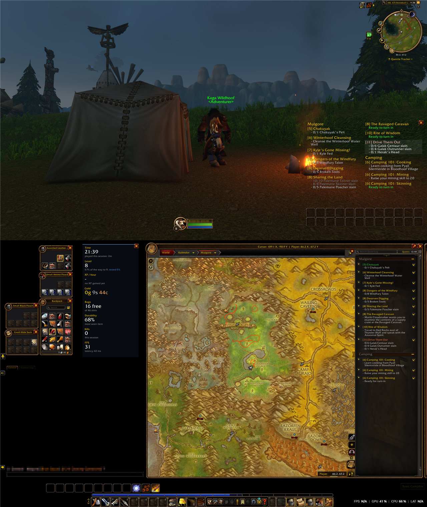
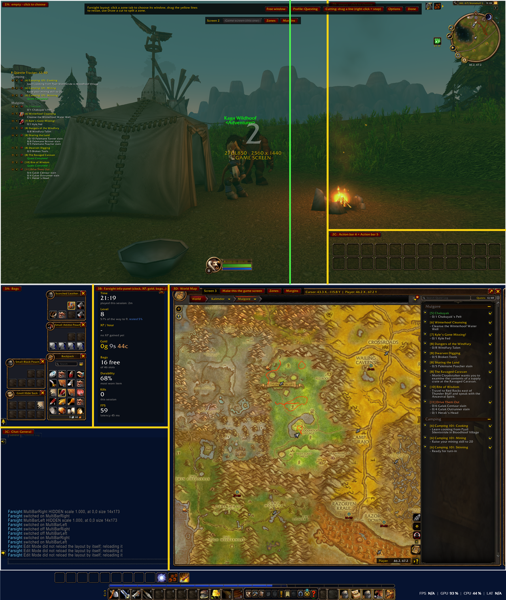

# Farsight: multi-monitor World of Warcraft

> 🖥️🖥️ **A multi-monitor addon.** Farsight spreads WoW across two, three or more screens. The 3D world stays on one screen, and your map, bags, chat, action bars and quests get the others.

Made for **WoW Forever**. Free and open source: **[github.com/womcraft/Farsight](https://github.com/womcraft/Farsight)**

---

## What you need

Farsight has two parts. You need both to play across several screens:

| Part | What it does |
|---|---|
| **Farsight** (this addon) | Shows the 3D world only on the game screen and places windows in zones on the other screens. |
| **Farsight Launcher** (Windows app) | Finds your screens, lets you pick which ones WoW should cover, and stretches the WoW window across them. |

👉 **Download the launcher here: [github.com/womcraft/Farsight/releases](https://github.com/womcraft/Farsight/releases/latest)**

The launcher is Windows only. Windows may warn about an unknown app because it is not signed: click **More info**, then **Run anyway**. The full source is on GitHub, and you can build it yourself.

If you stretch the WoW window with another tool, the addon also works without the launcher: type `/farsight` and enter your screens by hand.

---

## Features

- 🖥️ **Any monitor setup:** stacked, side by side, three screens, L-shapes. Screens with different resolutions work.
- 🎮 **One game screen:** the 3D world is drawn only on the screen you pick, in the right proportions.
- 🧩 **Zones:** split each screen into zones with ready-made layouts, or cut your own with the mouse.
- 🪟 **Any window in any zone:** world map, bags, chat tabs, character, vendor, mail, bank, auction house and about thirty more. Open windows of other addons are listed too (for example the Questie tracker), and "Pick any window with the mouse" catches the rest.
- 🎛️ **Action bars and unit frames in zones:** action bars, player, target and party frames, minimap, quest tracker, buffs and cast bar. Several bars in one zone are stacked edge to edge, and Farsight can turn them horizontal or vertical, or pick whichever makes them biggest.
- 📜 **Quest panel:** every quest in your log, spread over as many columns as make the text largest in its zone. Point at a quest to highlight it, click it to open it in the quest log.
- 📊 **Info panel:** clock, level and XP, XP per hour, gold, free bag slots, durability, kills and FPS. Its text grows with the zone.
- 📐 **Automatic sizing:** each window is scaled to fit its zone, stretched to fill it, or left at its own size.
- 📌 **Keep open:** Escape, NPC windows and the game menu no longer close the map, bags or any window you pin.
- 🎒 **Bags that fill the zone:** one combined bag, or separate bags stacked in a tall zone.
- 💬 **Chat in zones:** each chat tab can have a zone of its own.
- 🗂️ **Layout profiles:** several layouts, switched by hand or automatically for cities, dungeons and the open world. Share them as text.
- 🖐️ **Free windows:** keep a window anywhere without a zone, resize it with the mouse wheel.
- 👋 **First-start guide:** the first time, Farsight asks what you want on your other screen and sets it up in one click.
- 🔧 **Auto-calibrate:** one click sets the game area and UI scale from your screen resolutions.

---

## Getting started

1. Install this addon and **[download the launcher](https://github.com/womcraft/Farsight/releases/latest)**.
2. Start the launcher. **Click** the screens WoW should cover and **right-click** the one that should show the game.
   - Not sure which screen is which? Click **Identify screens** and a number appears on each one.
3. Press **Start**, then start WoW from Battle.net as usual. The launcher stretches the window.
4. In game, Farsight asks what you want on your other screen. Pick a ready-made setup and you are done.

Click **Create desktop shortcut** in the launcher to do all of this with one double-click next time.

---

## Layout mode

Open it with `/farsight layout` or a left-click on the minimap button.

| Control | What it does |
|---|---|
| **Zone tab** | Choose the window (or several bars) for that zone, its size, Keep open, bar direction; split or remove the zone |
| **Zones** | Start from a ready-made split of the screen |
| **Draw a cut** | A line follows the mouse: the mouse wheel turns it, a click splits the zone there, right-click stops |
| **Yellow lines** | Drag to resize zones |
| **Margins** | Keep space free at the screen edges |
| **Profile** | Switch, create, delete, export or import layout profiles, and set automatic switching |
| **Free window** | Keep a window in a place of its own: drag its handle, mouse wheel to resize, right-click to release |
| **Game screen** | Make that screen the one that shows the 3D world |

---

## Commands

| Command | Description |
|---|---|
| `/farsight` (or `/far`) | Open the options window |
| `/farsight layout` | Open layout mode |
| `/farsight auto` | Auto-calibrate: game area, UI scale and UI placement back to automatic |
| `/farsight profile <name>` | Switch layout profile. Without a name it lists them |
| `/farsight next` | Switch to the next layout profile |
| `/farsight info` | Show or hide the info panel |
| `/farsight quests` | Show or hide the quest panel |
| `/farsight welcome` | Show the first-start guide again |
| `/farsight on` / `off` | Enable or disable Farsight |
| `/farsight status` | Show what Farsight knows about your screens |
| `/farsight reset` | Clear the layout |
| `/farsight debug` | Print what the addon does to chat |

Key bindings for layout mode, next profile, the info panel and the options window are in WoW's key binding settings under Farsight.

---

## Works with other addons

Farsight needs no other addon. The options window shows which of these it found and how it works with them.

- **MoveAny:** windows you put in a Farsight zone follow Farsight; everything else stays under MoveAny's control. A window you just put in a zone may need one `/reload` before MoveAny lets go of it. If MoveAny moves an action bar or unit frame, turn that element off in MoveAny before you put it in a zone.
- **OpenMap:** the map can be stretched to fill its zone, and quests from the quest panel open in OpenMap's quest log.
- **Questie:** the Questie tracker can go in a zone like any other window, or use Farsight's quest panel instead.

---

## Good to know

- Farsight pauses itself when the WoW window is not stretched, so the game looks normal if you start it without the launcher.
- Windows can only be moved outside combat. Changes made in combat are applied when combat ends.
- Changing a bar's direction edits your Edit Mode layout. WoW's preset layouts cannot be changed, so Farsight first copies yours to a new layout named "Farsight".
- To go back to normal WoW, click **Restore normal WoW** in the launcher with the game closed.

---

## Something looks wrong?

- **Zoomed in, or the world on every screen:** type `/farsight auto`, or click **Auto-calibrate** in the launcher and type `/reload`.
- **A window does not follow its zone:** if you use MoveAny, type `/reload` once.
- **Anything else:** type `/farsight status` and `/farsight debug` and include what they print when you report the problem, here or on **[GitHub](https://github.com/womcraft/Farsight/issues)**.

---

**Source code, launcher download and issues:** [github.com/womcraft/Farsight](https://github.com/womcraft/Farsight). Public domain (The Unlicense): do whatever you want with it.
