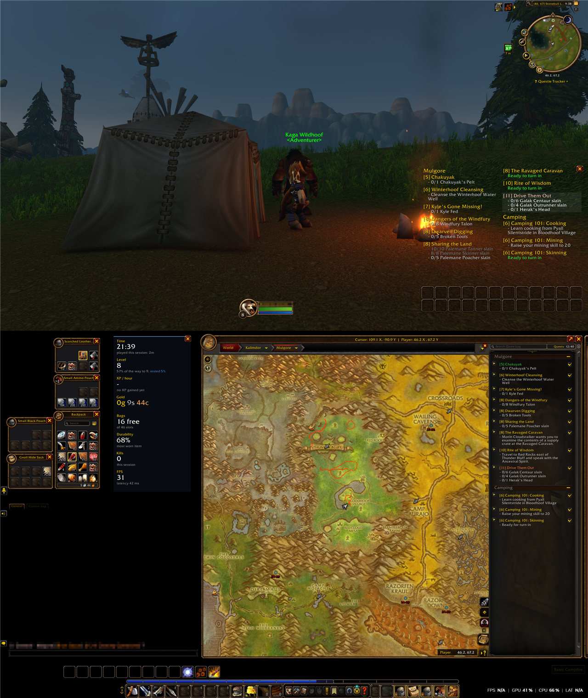
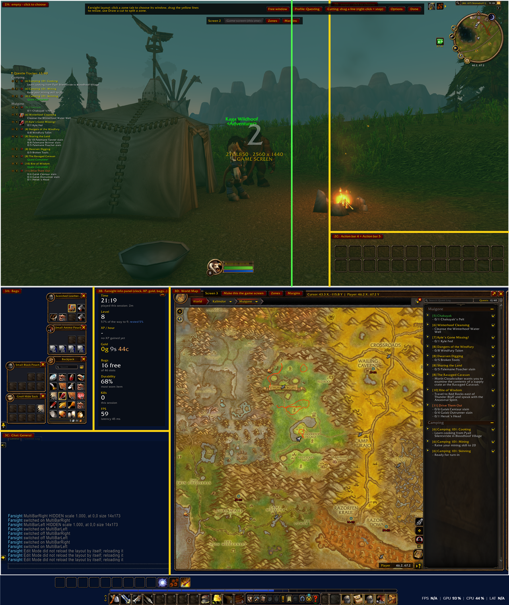

# Farsight

Play **World of Warcraft** across several screens: the 3D world on one screen, and your map, bags, character window and anything else on the others.

Farsight has two parts:

| Part | What it does |
|---|---|
| **Farsight Launcher** (Windows app) | Finds your screens, lets you pick which ones WoW should cover, stretches the WoW window across them and keeps it there. |
| **Farsight** (WoW addon) | Shows the 3D world only on the game screen and places windows in zones on the other screens. |

Any screen arrangement works: stacked, side by side, three screens, L-shapes.

**[Download the latest version](https://github.com/womcraft/Farsight/releases/latest)**: `Farsight-x.y.z.zip` has the launcher and the addon, `Farsight-x.y.z-addon.zip` only the addon.

---

## Install

1. Unzip the folder anywhere, for example `Documents\Farsight`.
2. Run **FarsightLauncher.exe**.
   - Windows may warn about an unknown app, because the launcher is not signed with a paid certificate. Click **More info**, then **Run anyway**. The full source is in `launcher/` and you can build the exe yourself (see the end of this page).
3. Check that the launcher found your **WoW folder** and the right game version (for example `_forever_`).
4. Click **Install addon**. Skip this if you installed the addon with the CurseForge app.

## First start

1. In the launcher, **click the screens** WoW should cover. They turn blue.
   - Not sure which is which? Click **Identify screens**: a number appears on each screen.
2. **Right-click** the screen that should show the game. It turns green.
3. Click **Start**. Battle.net opens. Press **Play** as usual.
4. WoW starts stretched across your screens. The launcher sits next to the clock and keeps the window in place.

Click **Create desktop shortcut** to get a "WoW (Farsight)" icon that does all of this in one double-click.

## Set up your windows (in game)

The first time WoW starts stretched, Farsight asks what you want on your other screen and offers three ready-made setups: map and bags; map, bags and chat; or map, bags, chat and the info panel. Pick one and you are done. Open the guide again with `/farsight welcome`.

To change things, type `/farsight layout` or left-click the Farsight button on the minimap. Every screen gets a number and a small toolbar.

1. Click **Zones** on a screen to start from a ready-made split.
2. Click **Draw a cut** at the top. A line follows the mouse; turn it between vertical and horizontal with the mouse wheel and click to split the zone there. Right-click to stop.
3. Click a **zone tab** (for example `3A: empty`) and choose the window that should live there.
   - Windows of other addons that are open right now are listed under **Other addons**, for example the Questie tracker.
   - A window that is not in the list? Choose **Pick any window with the mouse** and click it.
4. Drag the **yellow lines** to resize zones.
5. Click **Margins** to keep space free at the screen edges.
6. Click **Done**, or press ESC.

In the zone menu you can also set:

- **Keep open:** ESC, NPC windows and the game menu do not close the window. Only its own key or its X button does.
- **Size:** scale to fit the zone, stretch to fill it, or keep its own size.
- **Split** or **remove** the zone.

What you can put in a zone:

- **Windows:** world map, bags, character, vendor, mail, bank and about thirty more.
- **Chat:** every chat tab is listed as "Chat: name".
- **Interface parts:** action bars, player, target and party frames, the minimap, the quest tracker, buffs and the cast bar. Farsight scales bars to fit the zone and can turn them horizontal or vertical for you. A zone can hold several bars: tick more than one in the zone menu and they are stacked edge to edge with no gap. Click a ticked bar again to take it out. Each zone can also set **Bar direction**: horizontal, vertical, or auto (whichever makes the bars biggest in the zone). This changes the bar in your Edit Mode layout; WoW's preset layouts cannot be changed, so Farsight first copies yours to a new layout named "Farsight". A bar that is switched off in WoW is switched on when you put it in a zone, and off again when you take it out.
- **Info panel:** Farsight's own panel with clock, XP, gold, bag space, durability, kills and FPS. Choose its rows in its zone menu.
- **Quest panel:** every quest in your log with its objectives, spread over as many columns as make the text largest in its zone. A quest is never split between columns. Point at a quest to highlight it, click it to open it in the quest log. Its background is transparent by default; both panels can be switched between transparent and solid in the options or the zone menu.

**Free windows:** click **Free window** at the top to keep a window in a place of its own without a zone. Drag its green handle to move it, use the mouse wheel over the handle to change its size, and right-click the handle to release it.

**Profiles:** click **Profile** at the top to save several layouts, switch between them, share one as text (export and import), or have Farsight switch automatically for cities, dungeons and the open world. Shift-click the minimap button to go to the next profile.

**Key bindings:** WoW's key binding settings have a Farsight section for layout mode, next profile, the info panel and the options window.

## Options (`/farsight`)

- **Game screen** and **game area**: which screen shows the 3D world, with exact pixel values if you want to fine-tune (for example a 16:9 area on an ultrawide).
- **UI scale**: set automatically from your screens, or pick your own.
- **Keep open**: bags and world map.
- **Screens**: tick "Enter the screens by hand" to edit every screen's position and size yourself.

## Commands

| Command | Does |
|---|---|
| `/farsight` | Options window |
| `/farsight layout` | Layout editor |
| `/farsight status` | Shows the screens Farsight knows about |
| `/farsight on` / `off` | Enable or disable |
| `/farsight auto` | Auto-calibrate: game area, UI scale and UI placement back to automatic |
| `/farsight profile <name>` | Switch layout profile (no name: list them) |
| `/farsight next` | Switch to the next layout profile |
| `/farsight info` | Show or hide the info panel |
| `/farsight quests` | Show or hide the quest panel |
| `/farsight welcome` | Show the first-start guide again |
| `/farsight reset` | Clear the layout |
| `/farsight debug` | Print what the addon does to chat |

## Works with other addons

Farsight needs no other addon. If you have these, it works together with them, and the options window tells you what it found:

- **MoveAny:** windows you put in a Farsight zone follow Farsight. MoveAny's saved position and size for those windows are set aside and come back if you take the window out of its zone. Everything else stays under MoveAny's control. A window you just put in a zone may need one `/reload` before MoveAny lets go.
- **OpenMap:** the map can be stretched to fill its zone. Without OpenMap, WoW's own map keeps its shape and is scaled to fit.
- **Without either:** Farsight moves, sizes and keeps open every window you put in a zone by itself.

**Map always open:** normally WoW closes the map when you talk to an NPC or vendor, and Farsight opens it again afterwards. The option "Keep the map open beside NPC, vendor and other windows too" stops that. It is marked experimental: if the map ever refuses to close in combat, turn it off.

## Good to know

- **Start WoW through the launcher.** If WoW is not stretched, the addon pauses itself and WoW looks normal.
- **Changed screens in the launcher while WoW is running?** Type `/reload` in game.
- **Something looks wrong (zoomed in, world on every screen):** click **Auto-calibrate** in the launcher and type `/reload` in WoW, or type `/farsight auto` in game. Game area, UI scale and UI placement go back to automatic.
- **Back to normal WoW:** click **Restore normal WoW** in the launcher (with WoW closed).
- **OpenMap** and **MoveAny** work together with Farsight. With OpenMap the map can be stretched to fill its zone.
- Windows cannot be moved during combat. Changes are applied when combat ends.
- Very large windows (three high-resolution screens) cost frame rate.

## Building the launcher yourself

Run `launcher\build.bat`. It uses the C# compiler that ships with Windows; nothing needs to be installed.

## License

MIT, see [LICENSE](LICENSE).
